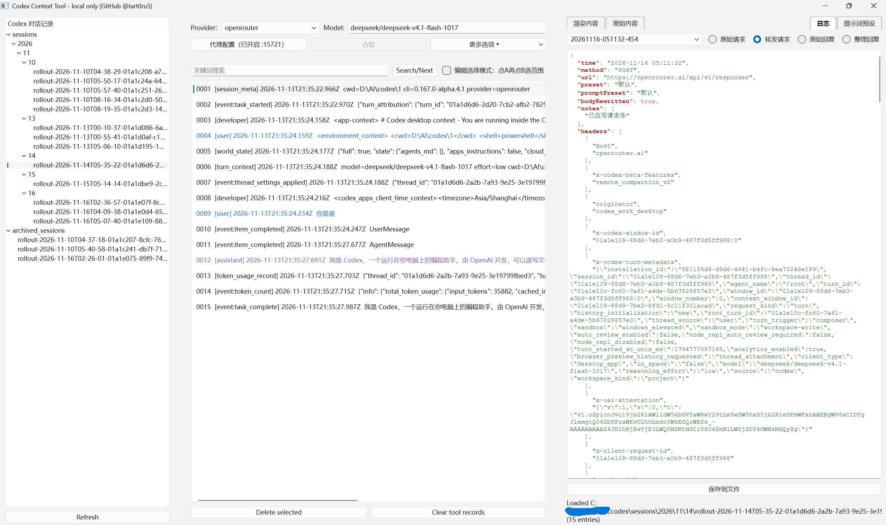
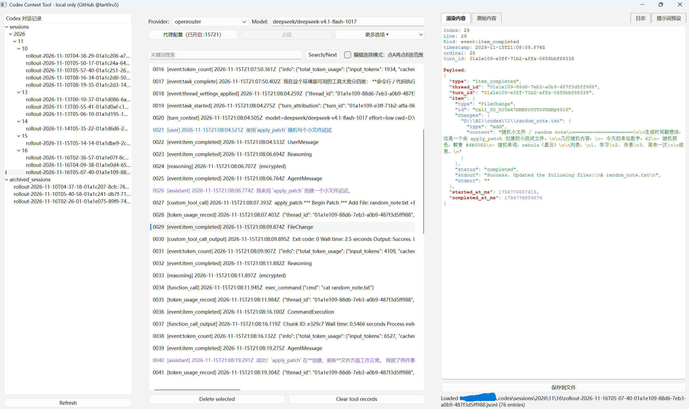
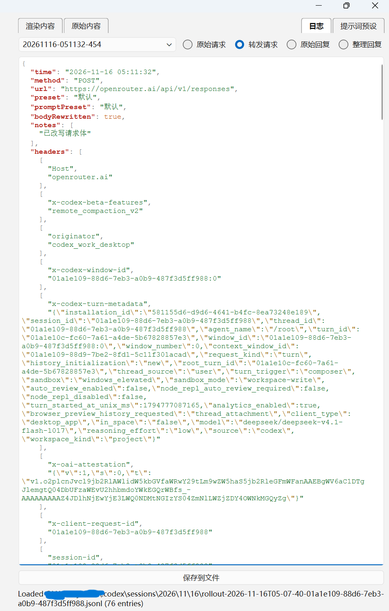
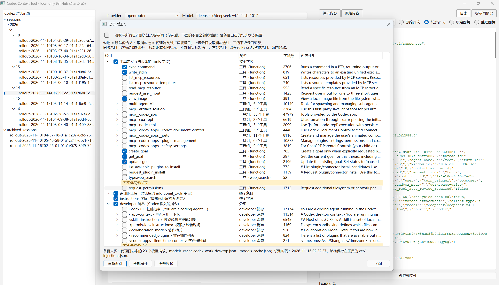
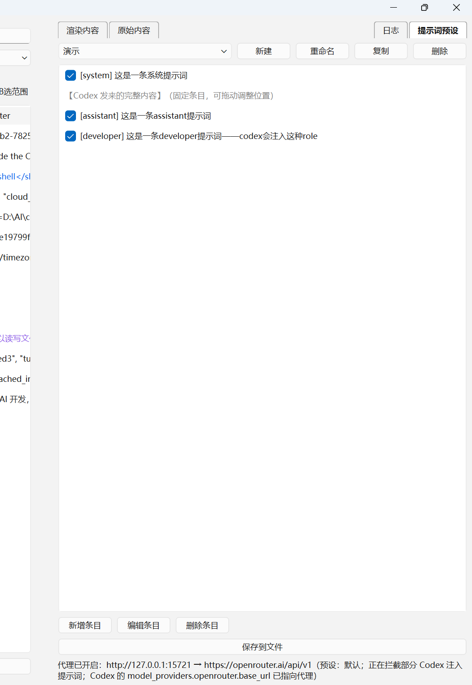
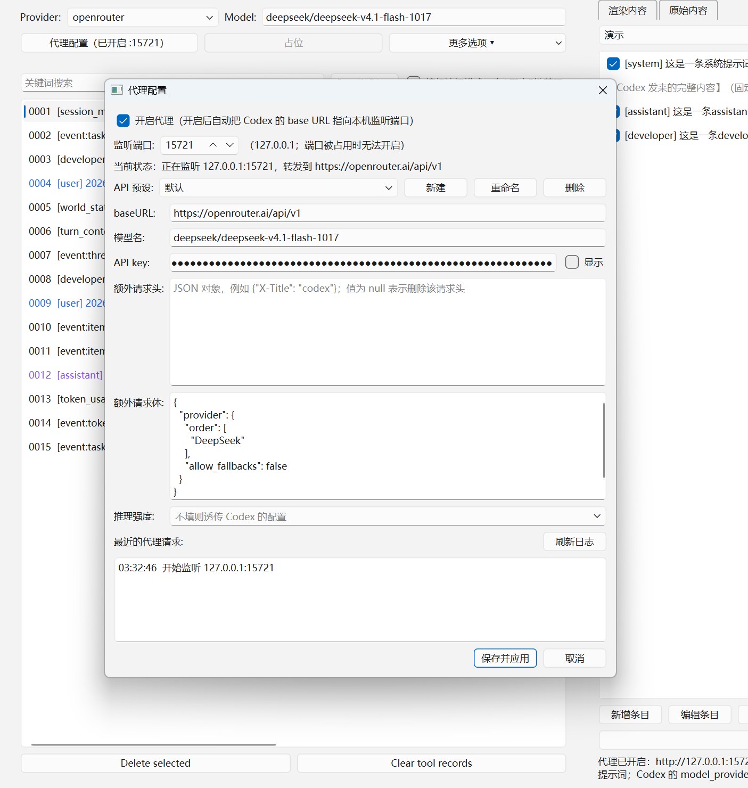

# Codex Context Tool

你是否已无法忍受闭源agent不可定制化的傲慢？
本工具会建立一个本地中转代理，帮你定制codex应该如何工作。

## 简介

- 读取本地的对话记录文件，方便地看清codex不给看的中间工具调用过程。

- 记录codex究竟发送了什么内容，从上游收到了什么回复，方便排查任何潜在的问题。

- 检测codex插入的提示词和工具，你可以精细控制codex注入哪些提示词。

- 你可以创建自己的提示词模板，以任何role插入自己想要的提示词。

- 也集成了类似cc switch那样的provider预设，可以一键切换provider。也支持插入额外的请求头或请求体。

## 许可证

本项目以 [GNU General Public License v3.0](LICENSE) 发布。

Copyright (C) 2026 [@tart0ru5](https://github.com/tart0ru5)
